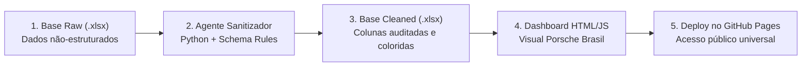

# Porsche Sales Intelligence Dashboard & Data Sanitization

🔗 **Dashboard Online (GitHub Pages):** [https://SEU-USUARIO.github.io/porsche-sales-dashboard/](https://SEU-USUARIO.github.io/porsche-sales-dashboard/)  
*(Substitua `SEU-USUARIO` pelo seu nome de usuário no GitHub)*

---

## Executive Summary:

Dados operacionais de vendas frequentemente chegam em formatos inconsistentes (datas inválidas, preços com símbolos mistos, unidades de quilometragem heterogêneas e erros de digitação), inviabilizando tomadas de decisão confiáveis. Neste projeto, construí um pipeline completo de ponta a ponta: criei um agente de tratamento com regras estritas de validação em Python (`schema.md`), higienizei uma base com 100 transações de veículos Porsche e desenvolvi uma **Dashboard Executiva Interativa em HTML/JS**, inspirada na identidade visual refinada da **Porsche Brasil**.

Após analisar os dados higienizados e responder às principais perguntas de negócio, identifiquei oportunidades estratégicas claras para a diretoria comercial:

1. **Priorização de Estoque no Ano-Modelo 2024:** O ano de 2024 respondeu por quase 30% de todo o volume comercializado, indicando forte preferência por tecnologia de ponta e modelos do ano corrente.
2. **Segmentação Geográfica por Perfil de Veículo:** Praças com tráfego denso (Atlanta, Phoenix, Denver) concentram volume nas linhas SUV (*Cayenne* e *Macan*), enquanto polos costeiros e de inovação (Seattle, Boston, San Diego) sustentam os maiores tíquetes médios em esportivos clássicos (*911*) e elétricos (*Taycan*).
3. **Estruturação de Meios de Pagamento:** Mais de 50% das transações foram liquidadas via *Wire Transfer* e *Financing*, demandando canais bancários corporativos ágeis para compras acima de $150.000.

---

### Business Problem:

Planilhas de vendas brutas acumulavam registros despadronizados que impediam a geração de relatórios precisos no Excel. Sem perguntas de negócio claras, dashboards tornam-se apenas "amontoados de gráficos" sem utilidade prática. 

Para extrair inteligência real dos dados, o projeto foi estruturado em torno de **três perguntas de negócio centrais**:

1. **Quais os principais modelos de carros vendidos por cidade?**  
   *Por quê:* Entender a preferência regional de produtos para otimizar alocação de frota e estoque por concessionária em cada praça.
2. **Qual o ano de modelo de carro que mais saiu em um período?**  
   *Por quê:* Identificar se a demanda do consumidor está centrada em seminovos, modelos do ano vigente ou lançamentos futuros.
3. **Quais são os insights de carros populares de vendas com base nos dados em cada cidade?**  
   *Por quê:* Identificar padrões de comportamento de compra (preferência por SUVs familiares vs. ícones esportivos vs. elétricos) cruzando volume, ticket médio e modalidade de liquidação financeira.

---

### Dashboard Preview:

> *Dica: Tire um print da sua tela e salve como `dashboard-preview.png` nesta pasta para que a imagem apareça automaticamente no GitHub.*


---

### Methodology:

O projeto seguiu um fluxo estruturado em 4 etapas:



1. **Definição de Schema & Regras de Sanitização (`schema.md`):**  
   Mapeamento canônico de entrada e saída. Regras estritas para converter moedas despadronizadas, traduzir unidades (milhas vs. KM com fator `1 km = 0.621371 mi`), unificar nomenclaturas de trims da Porsche, validar siglas USPS de estados americanos e converter anomalias calendárias (ex: 30 de fevereiro, 31 de abril) no indicador `INVALID`.

2. **Agente de Tratamento de Dados em Python (`porsche_data_sanitizer.py`):**  
   Desenvolvimento de script autônomo com `pandas` e `openpyxl`. O agente processa a base bruta mantendo os dados originais e gerando o arquivo `porsche_database_cleaned.xlsx`, com formatação condicional (azul para colunas brutas, verde para sanitizadas e vermelho para valores inválidos).

3. **Engenharia de Prompt & Geração da Dashboard (`build_dashboard.py`):**  
   Utilização de agente de IA com skill de montagem de dashboards para gerar um arquivo único em HTML/CSS/JavaScript nativo (`index.html`), com layout luxuoso baseado no portal da Porsche Brasil, filtros dinâmicos e biblioteca Chart.js integrada.

4. **Publicação no GitHub Pages:**  
   Subida do repositório público e deploy contínuo via GitHub Pages.

---

### Skills & Tecnologias Utilizadas:

* **Python:** `pandas`, `openpyxl`, `word2number`, manipulação de expressões regulares (`re`), conversão de datas ISO 8601.
* **Engenharia de Prompt & Agentes de IA:** Desenvolvimento de regras canônicas de sanitização e refinamento iterativo de componentes visuais em linguagem natural.
* **Data Visualization & Front-end:** HTML5 semântico, CSS3 moderno (paleta oficial Porsche, efeitos de profundidade, glassmorphism), JavaScript ES6+ reativo e Chart.js 4.4.
* **Governança de Dados:** Validação de schemas, tratamento de valores faltantes/inválidos e auditoria de integridade.
* **Git & GitHub Pages:** Versionamento de código e publicação web serverless.

---

### Agente & Prompts Utilizados:

Neste projeto utilizei a abordagem com **Agente de IA especializado em pipeline de dados e desenvolvimento de interface**, comparando e refinando os resultados por etapas:

#### Prompt 1 — Definição do Schema de Sanitização:
> *"Crie um arquivo markdown (`schema.md`) contendo a especificação canônica de dados de entrada e saída para a base de vendas da Porsche, contendo regras de normalização para datas ISO, modelos válidos, conversão de moedas, quilometragem em inteiros com conversão de KM para milhas, estados USPS e tratamento de anomalias com `INVALID`."*

#### Prompt 2 — Implementação do Agente Sanitizador:
> *"Crie um agente em Python que leia o arquivo `porsche_database_raw.xlsx`, aplique as regras do `schema.md` e gere um novo arquivo `porsche_database_cleaned.xlsx` mantendo o arquivo raw intacto. As colunas tratadas devem aparecer imediatamente ao lado de suas respectivas fontes, com cabeçalhos e células estilizados por cores diferenciadas no Excel."*

#### Prompt 3 — Construção da Dashboard Executiva (Refinamento Final):
> *"Usando o arquivo `porsche_database_cleaned.xlsx`, crie um dashboard executivo em HTML (arquivo único). Requisitos obrigatórios:*  
> *- Filtros interativos: Famílias de modelos (911, 718, Cayenne, Macan, Panamera, Taycan), Modelo específico, Cidade, Ano do modelo e Métodos de pagamento.*  
> *- Respostas visuais e em indicadores para as 3 perguntas de negócio: principais modelos por cidade, ano com maior saída e insights de popularidade por praça.*  
> *- UI/UX elegante, minimalista e refinado baseado no site oficial da Porsche Brasil (`https://www.porsche.com/brazil/pt/`), com paleta Obsidian Black, toques de Porsche Carmine Red e fontes elegantes.*  
> *- Gráficos interativos (Chart.js), tabela com paginação e busca instantânea, e botão de exportação para CSV."*

---

### Results & Business Recommendations:

A aplicação da dashboard permitiu que gestores e analistas filtrem qualquer fatia de mercado instantaneamente, eliminando relatórios manuais em planilhas.

#### 📌 Principais Resultados Encontrados:
* **Faturamento Total:** **$12.827.800,50** distribuídos em 100 vendas.
* **Ano Campeão de Vendas:** O ano de **2024** liderou com **29 veículos vendidos** (29% do market share total). Somado a 2023 (19 vendas), veículos recentes representam quase metade do faturamento.
* **Modelos Mais Vendidos:** *Cayenne Coupe* (4), *Taycan 4S* (4), *Cayenne E-Hybrid* (4), *911 Carrera* (4), *Macan Electric* (4) e *Macan T* (4).
* **Distribuição Geográfica:** 79 cidades atendidas. Atlanta foi a praça com maior número de transações (3 unidades), seguida por Boston, Seattle, Austin, Denver, San Diego, Chicago, Phoenix, Dallas e Las Vegas com 2 vendas cada.
* **Meios de Pagamento:** *Wire Transfer* foi a modalidade dominante (26 transações), seguida por *Credit Card* (15) e *Financing* (13).

```
   Distribuição por Ano do Modelo:
   2024: █████████████████████████████ 29 un. (29%)
   2023: ███████████████████ 19 un. (19%)
   2022: ████████████████ 16 un. (16%)
   2025: ████████████████ 16 un. (16%)
   2021: ████████████ 12 un. (12%)
   2020: ████ 4 un. (4%)
   2026: ████ 4 un. (4%)
```

#### 💡 Recomendações de Negócio:
1. **Campanhas Focadas em SUVs nas Regiões Centrais:** Direcionar campanhas de marketing de *Macan* e *Cayenne* para polos executivos urbanos onde a demanda por versatilidade premium supera a de coupés de dois lugares.
2. **Pacotes Especiais para a Frota Elétrica (Taycan):** Fortalecer parcerias de *Leasing* corporativo nas costas leste e oeste para acelerar a transição da linha elétrica.
3. **Eventos Exclusivos para a Linha 911:** Como a família 911 sustenta os maiores tíquetes médios (frequentemente acima de $200k), focar em eventos fechados para clientes de alta renda com liquidação direta.

---

### Estrutura de Arquivos do Repositório:

| Arquivo | Descrição |
|---|---|
| [`index.html`](index.html) | Dashboard interativo completo pronto para exibição no GitHub Pages |
| [`porsche_database_cleaned.xlsx`](porsche_database_cleaned.xlsx) | Base higienizada com colunas tratadas e estilização de cores |
| [`porsche_database_raw.xlsx`](porsche_database_raw.xlsx) | Base de dados bruta original com 100 registros |
| [`porsche_data_sanitizer.py`](porsche_data_sanitizer.py) | Script de sanitização que executa o pipeline de regras |
| [`schema.md`](schema.md) | Dicionário de dados, mapeamento canônico e regras de higienização |
| [`build_dashboard.py`](build_dashboard.py) | Script de automação que constrói a dashboard HTML |
| [`_dashboard_data.json`](_dashboard_data.json) | Dados higienizados estruturados em formato JSON |

---

### Next Steps:

1. **Aprimoramento Geográfico:** Incluir visualização em mapa de calor (Choropleth Map) por Estado (USPS).
2. **Métricas de Conversão de Entrega:** Desenvolver funil logístico analisando o tempo decorrido entre status `In Transit` e `Delivered`.
3. **Tratamento de Exceções Calendárias:** Criar rotina preditiva com Machine Learning para sugerir correção automática nas 24 datas marcadas como `INVALID`.

---

### Autor

Projeto desenvolvido como parte do desafio prático **Criando Agentes de Tratamento de Dados** da [Digital Innovation One (DIO)](https://www.dio.me/).
