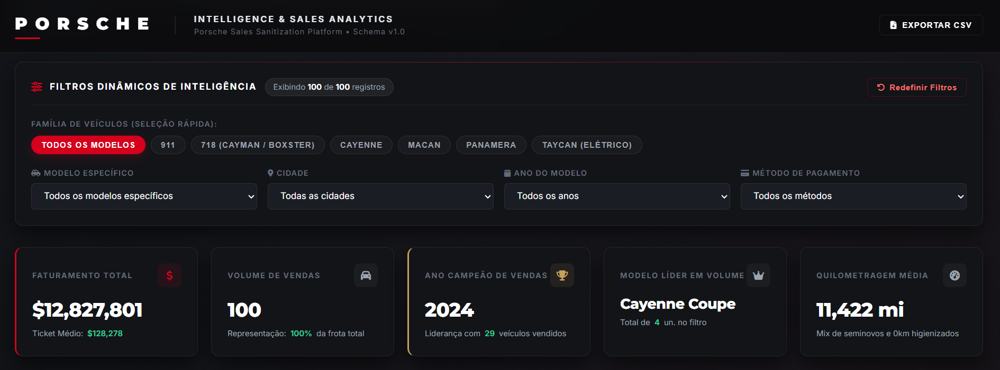

# Dashboard de Inteligência de Vendas Porsche & Higienização de Dados

🔗 **Dashboard Online (GitHub Pages):** [https://giovanycesar.github.io/porsche-sales-dashboard/](https://giovanycesar.github.io/porsche-sales-dashboard/)  

---

## Resumo Executivo:

Dados operacionais de vendas frequentemente chegam em formatos inconsistentes (datas inválidas, preços com símbolos mistos, unidades de quilometragem heterogêneas e erros de digitação), inviabilizando tomadas de decisão confiáveis. Neste projeto, construí um pipeline completo de ponta a ponta: criei um agente de tratamento com regras estritas de validação em Python (`schema.md`), higienizei uma base com 100 transações de veículos Porsche e desenvolvi uma **Dashboard Executiva Interativa em HTML/JS**, inspirada na identidade visual refinada da **Porsche Brasil**.

Após analisar os dados higienizados e responder às principais perguntas de negócio, identifiquei oportunidades estratégicas claras para a diretoria comercial:

1. **Priorização de Estoque no Ano-Modelo 2024:** O ano de 2024 respondeu por quase 30% de todo o volume comercializado, indicando forte preferência por tecnologia de ponta e modelos do ano corrente.
2. **Segmentação Geográfica por Perfil de Veículo:** Praças com tráfego denso (Atlanta, Phoenix, Denver) concentram volume nas linhas SUV (*Cayenne* e *Macan*), enquanto polos costeiros e de inovação (Seattle, Boston, San Diego) sustentam os maiores tíquetes médios em esportivos clássicos (*911*) e elétricos (*Taycan*).
3. **Estruturação de Meios de Pagamento:** Mais de 50% das transações foram liquidadas via *Wire Transfer* e *Financing*, demandando canais bancários corporativos ágeis para compras acima de $150.000.

---

### Problema de Negócio:

Planilhas de vendas brutas acumulavam registros despadronizados que impediam a geração de relatórios precisos no Excel. Sem perguntas de negócio claras, dashboards tornam-se apenas "amontoados de gráficos" sem utilidade prática. 

Para extrair inteligência real dos dados, o projeto foi estruturado em torno de **três perguntas de negócio centrais**:

1. **Quais os principais modelos de carros vendidos por cidade?**  
   *Por quê:* Entender a preferência regional de produtos para otimizar alocação de frota e estoque por concessionária em cada praça.
2. **Qual o ano de modelo de carro que mais saiu em um período?**  
   *Por quê:* Identificar se a demanda do consumidor está centrada em seminovos, modelos do ano vigente ou lançamentos futuros.
3. **Quais são os insights de carros populares de vendas com base nos dados em cada cidade?**  
   *Por quê:* Identificar padrões de comportamento de compra (preferência por SUVs familiares vs. ícones esportivos vs. elétricos) cruzando volume, ticket médio e modalidade de liquidação financeira.

---

### Demonstração do Dashboard:



---

### Metodologia:

O projeto seguiu um fluxo estruturado em 5 etapas:


1. **Ingestão da Base Bruta (`excel/porsche_database_raw.xlsx`):**  
   Diagnóstico inicial de 100 registros com discrepâncias de formatação em moedas, unidades mistas de quilometragem (milhas vs. quilômetros) e inconsistências de calendário.

2. **Definição de Schema & Regras Canônicas (`schema.md`):**  
   Mapeamento de tipos de entrada e saída. Regras estritas para converter moedas despadronizadas, traduzir unidades (`1 km = 0,621371 mi`), unificar nomenclaturas de trims da Porsche, validar siglas USPS de estados americanos e converter anomalias calendárias (ex: 30 de fevereiro, 31 de abril) no indicador `INVALID`.

3. **Agente Sanitizador em Python (`python/porsche_data_sanitizer.py`):**  
   Execução de script autônomo com `pandas` e `openpyxl`. O agente processa a base bruta mantendo os dados originais intactos e gerando o arquivo `excel/porsche_database_cleaned.xlsx`, com formatação condicional (azul para colunas brutas, verde para sanitizadas e vermelho para valores inválidos).

4. **Construção da Dashboard Executiva (`index.html` via `python/build_dashboard.py`):**  
   Geração de interface em arquivo único com Chart.js, filtros dinâmicos e identidade visual inspirada no portal oficial da Porsche Brasil.

5. **Deploy & Publicação no GitHub Pages:**  
   Subida do repositório público e deploy contínuo via GitHub Pages com link de acesso universal e responsivo.

---

### Habilidades & Tecnologias Utilizadas:

* **Python:** `pandas`, `openpyxl`, `word2number`, manipulação de expressões regulares (`re`), conversão de datas ISO 8601.
* **Engenharia de Prompt & Agentes de IA:** Desenvolvimento de regras canônicas de sanitização e refinamento iterativo de componentes visuais em linguagem natural.
* **Visualização de Dados & Front-end:** HTML5 semântico, CSS3 moderno (paleta oficial Porsche, efeitos de profundidade, glassmorphism), JavaScript ES6+ reativo e Chart.js 4.4.
* **Governança de Dados:** Validação de schemas, tratamento de valores faltantes/inválidos e auditoria de integridade.
* **Git & GitHub Pages:** Versionamento de código e publicação web serverless.

---

### Agente & Prompts Utilizados:

Neste projeto, utilizei a abordagem com **Agente de IA especializado em pipeline de dados e desenvolvimento de software**, refinando as instruções por etapas iterativas para garantir rigor analítico e fidelidade visual:

---

#### 🔹 Etapa 1: Definição do Schema de Sanitização
* **Objetivo:** Estabelecer um contrato canônico de dados para mapear tipos, formatos válidos e regras de conversão.
* **Prompt Utilizado:**
> *"Crie um arquivo Markdown (`schema.md`) contendo a especificação canônica de dados de entrada e saída para a base de vendas da Porsche. Inclua regras formais de normalização para datas no padrão ISO 8601 (`YYYY-MM-DD`), padronização dos modelos e trims válidos da marca, limpeza de valores monetários em USD, conversão de quilometragem de quilômetros para milhas (fator de conversão `1 km = 0,621371 mi`), validação de estados conforme a sigla oficial USPS de duas letras e tratamento rigoroso de anomalias com a marcação `INVALID`."*

---

#### 🔹 Etapa 2: Implementação e Refinamento do Agente Sanitizador (Python)
* **Objetivo:** Criar um script automatizado com `pandas` e `openpyxl` que aplique as regras e formate a planilha Excel preservando os dados brutos.
* **Prompt Utilizado:**
> *"Crie um agente em Python que leia o arquivo `porsche_database_raw.xlsx` e aplique as regras definidas no `schema.md` para gerar um novo arquivo tratado (`porsche_database_cleaned.xlsx`), mantendo o arquivo bruto original intacto.*  
> *Requisitos de formatação:*  
> *1. Insira as colunas sanitizadas imediatamente após as suas respectivas colunas de origem;*  
> *2. Aplique formatação condicional com estilos e cores distintas no Excel para diferenciar visualmente as colunas originais (em azul escuro/claro), as colunas tratadas (em verde escuro/claro) e destaque os registros inválidos com fundo vermelho claro e texto em negrito."*
* **Evolução do Prompt:** A instrução inicial previa apenas a limpeza básica; foi refinada para exigir a preservação estrita da base original (*raw*), o posicionamento intercalado das colunas e a estilização condicional via `openpyxl`.

---

#### 🔹 Etapa 3: Construção e Refinamento da Dashboard Executiva (HTML/JS)
* **Objetivo:** Transformar a base tratada em uma interface analítica interativa de arquivo único (`index.html`), pronta para publicação no GitHub Pages.
* **Prompt Utilizado:**
> *"Com base no arquivo `porsche_database_cleaned.xlsx`, gere uma dashboard executiva interativa em HTML (arquivo único e autocontido). Requisitos obrigatórios:*  
> *- **Filtros Dinâmicos:** Seletor rápido por família de veículos (911, 718, Cayenne, Macan, Panamera e Taycan), filtros detalhados por modelo específico, cidade, ano do modelo e método de pagamento, além de busca textual global e botão de redefinição;*  
> *- **Perguntas de Negócio & KPIs:** Módulos visuais e indicadores que respondam diretamente:*  
> *  1. Quais os principais modelos de carros vendidos por cidade?*  
> *  2. Qual o ano de modelo de carro que mais saiu no período?*  
> *  3. Quais os insights de carros populares de vendas com base nos dados de cada cidade?*  
> *- **Identidade Visual & UI/UX:** Design elegante, refinado e minimalista inspirado no portal oficial da Porsche Brasil (`https://www.porsche.com/brazil/pt/`), utilizando a paleta Obsidian Black, detalhes em Porsche Carmine Red (`#d5001c`), tipografia geométrica premium e cartões em glassmorphism;*  
> *- **Recursos Analíticos:** Gráficos interativos com Chart.js, tabela transacional com ordenação e paginação, e funcionalidade de exportação dos dados filtrados para CSV."*
* **Evolução do Prompt:** O prompt evoluiu de uma solicitação genérica de gráficos para um briefing técnico detalhado, com parâmetros estéticos estritos da Porsche e amarração direta entre as perguntas de negócio e os componentes de UI.

---

### Resultados & Recomendações de Negócio:

A aplicação da dashboard permitiu que gestores e analistas filtrem qualquer fatia de mercado instantaneamente, eliminando relatórios manuais em planilhas.

#### 📌 Principais Resultados Encontrados:
* **Faturamento Total:** **$12.827.800,50** distribuídos em 100 vendas.
* **Ano Campeão de Vendas:** O ano de **2024** liderou com **29 veículos vendidos** (29% do market share total). Somado a 2023 (19 vendas), veículos recentes representam quase metade do faturamento.
* **Modelos Mais Vendidos:** *Cayenne Coupe* (4), *Taycan 4S* (4), *Cayenne E-Hybrid* (4), *911 Carrera* (4), *Macan Electric* (4) e *Macan T* (4).
* **Distribuição Geográfica:** 79 cidades atendidas. Atlanta foi a praça com maior número de transações (3 unidades), seguida por Boston, Seattle, Austin, Denver, San Diego, Chicago, Phoenix, Dallas e Las Vegas com 2 vendas cada.
* **Meios de Pagamento:** *Wire Transfer* foi a modalidade dominante (26 transações), seguida por *Credit Card* (15) e *Financing* (13).

```
   Distribuição por Ano do Modelo:
   2024: █████████████████████████████ 29 un. (29%)
   2023: ███████████████████ 19 un. (19%)
   2022: ████████████████ 16 un. (16%)
   2025: ████████████████ 16 un. (16%)
   2021: ████████████ 12 un. (12%)
   2020: ████ 4 un. (4%)
   2026: ████ 4 un. (4%)
```

#### 💡 Recomendações de Negócio:
1. **Campanhas Focadas em SUVs nas Regiões Centrais:** Direcionar campanhas de marketing de *Macan* e *Cayenne* para polos executivos urbanos onde a demanda por versatilidade premium supera a de coupés de dois lugares.
2. **Pacotes Especiais para a Frota Elétrica (Taycan):** Fortalecer parcerias de *Leasing* corporativo nas costas leste e oeste para acelerar a transição da linha elétrica.
3. **Eventos Exclusivos para a Linha 911:** Como a família 911 sustenta os maiores tíquetes médios (frequentemente acima de $200k), focar em eventos fechados para clientes de alta renda com liquidação direta.

---

### Estrutura de Arquivos do Repositório:

```text
porsche-sales-dashboard/
├── 📄 index.html                       # Dashboard no ar (raiz para o GitHub Pages)
├── 📄 README.md                        # Documentação executiva completa do projeto
├── 📄 schema.md                        # Regras e mapeamento canônico de sanitização
├── 📁 excel/
│   ├── porsche_database_raw.xlsx       # Base bruta original (100 registros)
│   └── porsche_database_cleaned.xlsx   # Base higienizada com colunas coloridas
├── 📁 json/
│   └── _dashboard_data.json            # Dados higienizados estruturados em JSON
├── 📁 png/
│   └── dashboard-preview.png           # Captura de tela da dashboard em operação
└── 📁 python/
    ├── porsche_data_sanitizer.py       # Agente autônomo de higienização de dados
    └── build_dashboard.py              # Script de automação e compilação do dashboard
```

| Arquivo / Pasta | Descrição |
|---|---|
| [`index.html`](index.html) | Dashboard executivo interativo pronto para exibição no GitHub Pages |
| [`schema.md`](schema.md) | Dicionário de dados, mapeamento canônico e regras de higienização |
| [`excel/porsche_database_cleaned.xlsx`](excel/porsche_database_cleaned.xlsx) | Base higienizada com colunas tratadas e estilização de cores |
| [`excel/porsche_database_raw.xlsx`](excel/porsche_database_raw.xlsx) | Base de dados bruta original com 100 registros |
| [`png/dashboard-preview.png`](png/dashboard-preview.png) | Captura de tela da dashboard utilizada na demonstração |
| [`python/porsche_data_sanitizer.py`](python/porsche_data_sanitizer.py) | Script do agente de sanitização que executa o pipeline de regras |
| [`python/build_dashboard.py`](python/build_dashboard.py) | Script de automação que constrói a dashboard HTML |
| [`json/_dashboard_data.json`](json/_dashboard_data.json) | Dados higienizados estruturados em formato JSON |

---

### Próximos Passos:

1. **Aprimoramento Geográfico:** Incluir visualização em mapa de calor (Choropleth Map) por Estado (USPS).
2. **Métricas de Conversão de Entrega:** Desenvolver funil logístico analisando o tempo decorrido entre status `In Transit` e `Delivered`.
3. **Tratamento de Exceções Calendárias:** Criar rotina preditiva com Machine Learning para sugerir correção automática nas 24 datas marcadas como `INVALID`.

---

### Autor

Projeto desenvolvido por **Giovany César** como parte do desafio prático **Criando Agentes de Tratamento de Dados** da [Digital Innovation One (DIO)](https://www.dio.me/).
